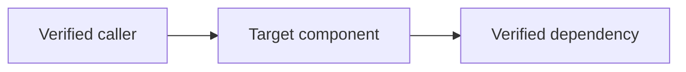

# <Component> — Architecture, design, and implementation

> Status: Evidence-backed technical documentation. Repository revision: `<commit/hash or unknown>`. Investigated paths: `<paths>`. Analysis date: `<date>`.

## 1. Scope

**IN:** `<component boundaries>`  
**CONTEXT:** `<adjacent symbols examined only for verification>`  
**OUT:** `<explicit exclusions>`

## 2. Purpose and responsibilities

Describe confirmed purpose, inputs, outputs, side effects, and invariants. Attach evidence at each substantive point.

## 3. Architecture and context

Replace all placeholders with verified names and interactions, or omit the diagram.

## 4. Public contracts and dependencies

| Contract/dependency | Direction | Verified behavior | Evidence | Certainty |
|---|---|---|---|---|
| ... | ... | ... | `path:Lx-Ly` | CONFIRMED |

## 5. Internal design

Abstractions, responsibilities, state and lifecycle, important design decisions. Discuss patterns only where implementation substantiates them.

## 6. Execution flows

For each relevant flow: trigger, ordered execution, validation and branching, side effects, result/failure, references.

## 7. Data and integrations

Relevant schemas, transformations, storage, messaging, caching, transactions, and boundaries. Distinguish direct behavior from delegated behavior.

## 8. Resilience, security, and observability

Include observed mechanisms with citations. For mechanisms not verified, write `Not verified in inspected paths` rather than declaring they do not exist.

## 9. Runtime wiring and configuration

Instantiation / DI / route or event registration / options / flags where verified.

## 10. Relevant tests

| Test | Behavior it checks | Limits | Evidence |
|---|---|---|---|
| ... | ... | ... | ... |

## 11. Evidence and uncertainty

| ID | Claim | Source | Certainty | Verification gap |
|---|---|---|---|---|
| C-01 | ... | `path:Lx-Ly` | CONFIRMED | — |
| I-01 | ... | `path:Symbol` | INFERRED | ... |

**Discrepancies:** source vs docs/tests when applicable.  
**Open questions:** unresolved behavior important to the component.

## 12. Verification status

Confirmed: `<n>` · Inferred: `<n>` · Unverified: `<n>` · Contradicted: `<n>`

**Limitations:** `<brief, explicit>`
