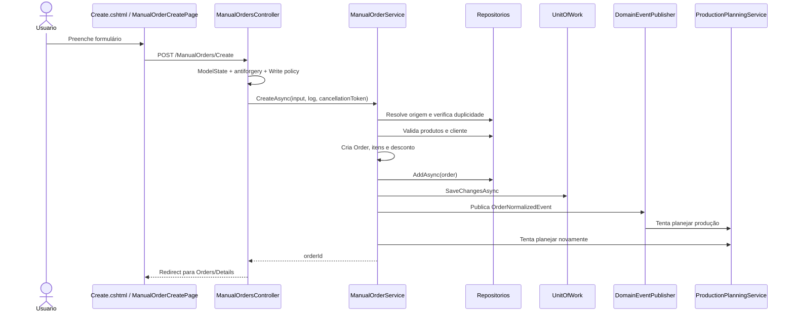

# Análise arquitetural — criação de pedidos manuais (`ManualOrders`)

## Escopo

**IN**

- `ManualOrdersController.Create`
- `ManualOrderService.CreateAsync`
- `ManualOrderInputModel`
- formulário Razor/Blazor de criação
- entidades `Order`, `OrderItem`, `OrderOrigin`
- persistência, eventos e planejamento de produção acionados pela criação

**CONTEXTO**

- repositórios de pedidos, clientes, produtos e origens
- `OrderProductionPlanningService`
- autorização, DI, logging e testes relacionados

**FORA**

- edição, exclusão e vinculação posterior de produtos, salvo quando necessários para explicar o fluxo de criação.

## Resumo

O fluxo é uma aplicação MVC com formulário Razor que envia `POST /ManualOrders/Create`. O controller valida o `ModelState` e delega a criação para `ManualOrderService`.

O serviço:

1. remove linhas de item vazias;
2. gera ou normaliza a referência externa;
3. exige data de envio futura;
4. resolve e valida a origem;
5. rejeita origem/referência duplicadas;
6. valida produtos internos informados;
7. resolve ou cria o cliente;
8. calcula o desconto;
9. cria a entidade `Order`;
10. persiste o pedido;
11. publica `OrderNormalizedEvent`;
12. tenta planejar a produção;
13. redireciona para os detalhes do pedido.

## Contexto e fluxo



A segunda chamada explícita ao planejamento é protegida contra duplicidade porque `TryPlanAsync` verifica se já existem tarefas para o pedido (`src/Domains/Production/Services/OrderProductionPlanningService.cs:46-62`). Portanto, há uma tentativa via evento e outra direta.

## Entrada e apresentação

O formulário é renderizado por `Create.cshtml`, que prepara produtos, origens, clientes, itens e token antiforgery (`src/App/Views/ManualOrders/Create.cshtml:6-70`).

O componente permite:

- origem;
- referência;
- data de envio;
- dados do cliente;
- itens;
- desconto percentual ou monetário.

O JavaScript calcula totais apenas para apresentação e ajusta índices dos itens (`src/UI/Components/ManualOrders/ManualOrderCreatePage.razor:244-347`). A validação efetiva ocorre no servidor.

### Observação importante

O campo de produto interno possui `required`, embora a opção “Sem vínculo” exista (`src/UI/Components/ManualOrders/ManualOrderCreatePage.razor:144-152`). Porém o serviço aceita `ProductId = null` e cria o pedido mesmo sem produto interno (`src/App/Services/ManualOrderService.cs:448-460`).

Isso indica uma divergência entre a validação HTML e o contrato do serviço:

- **CONFIRMADO:** o domínio permite item sem produto.
- **CONFIRMADO:** o formulário pode impedir esse cenário no navegador.
- **UNVERIFICADO:** não foi validado o comportamento em todos os navegadores ou quando o POST é feito diretamente.

## Contrato HTTP e autorização

O controller exige autenticação para leitura:

```csharp
[Authorize(Policy = ApplicationPolicies.Read)]
```

O POST exige adicionalmente a política `Write` e antiforgery (`src/App/Controllers/ManualOrdersController.cs:13-14`, `:37-40`).

As políticas são configuradas assim:

- `Read`: Admin, Operador ou Consulta;
- `Write`: Admin ou Operador.

Fonte: `src/App/Program.cs:55-64`.

Após sucesso, o controller grava `TempData["Success"]` e redireciona para `Orders/Details` (`src/App/Controllers/ManualOrdersController.cs:57-64`).

## Validações do serviço

### Pedido

- ao menos um item preenchido (`src/App/Services/ManualOrderService.cs:106-114`);
- referência automática no formato `MAN-...` quando ausente (`:116-120`);
- data de envio obrigatória e futura em UTC (`:122-130`);
- origem existente (`:132-133`);
- origem + referência não podem duplicar outro pedido (`:135-139`).

### Itens

`BuildOrderItemsAsync`:

- ignora linhas totalmente vazias;
- valida o produto, caso `ProductId` seja informado;
- gera `ExternalItemId` se ausente;
- cria `OrderItem` com quantidade, descrição, preço e produto (`src/App/Services/ManualOrderService.cs:427-464`).

A entidade reforça invariantes:

- descrição obrigatória;
- quantidade maior que zero;
- identificador externo obrigatório;
- preço não negativo.

Fontes: `src/Domains/Sales/Entities/OrderItem.cs:19-46` e `src/Domains/Sales/ObjectValues/Money.cs:11-25`.

### Cliente

Se qualquer dado de cliente for informado:

- nome torna-se obrigatório;
- o nome é normalizado;
- cliente existente pelo nome normalizado é reutilizado e atualizado;
- caso contrário, um novo cliente é criado.

Fonte: `src/App/Services/ManualOrderService.cs:481-514`.

O comportamento é coberto por testes de criação, atualização e reutilização por nome normalizado (`tests/Craftsman.Tests/Application/ManualOperationsTests.cs:91-154`).

### Desconto

Se o valor for zero ou negativo, nenhum desconto é criado.

Caso contrário:

- descrição é obrigatória;
- desconto percentual é calculado sobre o total bruto;
- desconto monetário é usado diretamente;
- o valor é arredondado para duas casas.

Fonte: `src/App/Services/ManualOrderService.cs:516-534`.

## Persistência e estado

A entidade `Order` inicia no status `Normalized` e gera `OrderNormalizedEvent` no construtor (`src/Domains/Sales/Entities/Order.cs:31-72`).

A persistência do pedido converte:

- origem para `Source` e `ExternalOrderId`;
- itens para `OrderItemEntity`;
- cliente para `CustomerId`;
- desconto para descrição e valor.

Fonte: `src/Infra/Repositories/OrderRepository.cs:51-55` e `:177-201`.

A busca de duplicidade compara `Source` e `ExternalOrderId` (`src/Infra/Repositories/OrderRepository.cs:30-39`).

### Limite transacional

**CONFIRMADO:** `CreateAsync` executa dois `SaveChangesAsync` e publica eventos entre eles (`src/App/Services/ManualOrderService.cs:153-163`).

**UNVERIFICADO/risco:** não há chamada a `ExecuteInTransactionAsync` no fluxo de criação. Portanto, não foi observada uma transação explícita envolvendo simultaneamente:

- pedido;
- evento persistido;
- tarefas de produção;
- movimentações de estoque.

O `UnitOfWork` oferece transações, mas isso não prova que elas sejam usadas neste caminho (`src/Infra/Repositories/UnitOfWork.cs:24-56`).

## Eventos e produção

O pedido gera `OrderNormalizedEvent`. O publisher persistente:

1. registra o evento no banco;
2. salva;
3. executa handlers;
4. registra sucesso ou falha do handler.

Fonte: `src/Infra/Services/PersistentDomainEventPublisher.cs:32-43` e `:45-119`.

O handler de `OrderNormalizedEvent` chama `TryPlanAsync` (`src/Domains/Production/Services/OrderNormalizedProductionPlannerHandler.cs:5-17`).

O planejamento somente prossegue quando todos os itens possuem produto interno (`src/Domains/Production/Services/OrderProductionPlanningService.cs:46-55`). Quando aplicável:

- cria tarefas de produção;
- marca o pedido como `ReadyForProduction`;
- persiste;
- publica eventos das tarefas.

Fonte: `src/Domains/Production/Services/OrderProductionPlanningService.cs:64-101`.

Pedidos com itens sem produto são persistidos, mas não são planejados automaticamente.

## Falhas e observabilidade

O controller trata:

- `ArgumentException`;
- `ArgumentOutOfRangeException`;
- `InvalidOperationException`.

Nesses casos, registra erro, adiciona mensagem ao `ModelState`, repopula as opções e retorna o formulário (`src/App/Controllers/ManualOrdersController.cs:57-71`).

O fluxo usa `LogData` com:

- método;
- rota;
- query;
- corpo da requisição;
- correlation ID;
- etapas internas;
- resultado ou tipo da exceção.

Fontes: `src/App/Controllers/ManualOrdersController.cs:42-52`, `:75-83` e `src/Domains/LogData.cs:26-99`.

### Risco observado

`LogData` serializa o corpo inteiro da requisição (`RequestBody`). Como o input contém telefone e e-mail do cliente, existe potencial de registrar PII no console (`src/Domains/LogData.cs:34-40`, `:60-65`).

- **Severidade:** média, dependendo da política de retenção e acesso aos logs.
- **Status:** não corrigido nesta análise.
- **Limitação:** não foi inspecionada a infraestrutura de coleta e retenção de logs.

O publisher registra `exception.Message` em caso de falha de handler (`src/Infra/Services/PersistentDomainEventPublisher.cs:106-116`).

## Wiring

`ManualOrderService` é registrado como `Scoped` (`src/App/Services/ApplicationServiceCollectionExtensions.cs:7-18`).

Suas dependências principais são registradas pela infraestrutura:

- `IOrderRepository`;
- `ICustomerRepository`;
- `IOrderSourceCatalogRepository`;
- `IProductRepository`;
- `IUnitOfWork`;
- `IDomainEventPublisher`;
- `OrderProductionPlanningService`.

Fonte: `src/Infra/Services/ServiceCollectionExtensions.cs:55-88`.

A origem `Manual` é criada pelo seeder de desenvolvimento (`src/Infra/Persistence/DevelopmentDataSeeder.cs:34-75`). O serviço também permite cadastrar novas origens (`src/App/Services/ManualOrderService.cs:370-380`).

## Testes relevantes

Os testes cobrem:

- criação com origem e referência;
- criação de cliente;
- reutilização de cliente;
- desconto monetário e percentual;
- data ausente;
- data passada;
- planejamento quando há produto interno;
- validação do controller;
- erros de origem desconhecida;
- registro de serviço no DI.

Fontes principais:

- `tests/Craftsman.Tests/Application/ManualOperationsTests.cs:31-185`
- `tests/Craftsman.Tests/Application/ManualOperationsTests.cs:253-380`
- `tests/Craftsman.Tests/Application/ManualOrdersControllerCoverageTests.cs:58-108`
- `tests/Craftsman.Tests/Application/ApplicationServiceCollectionExtensionsTests.cs:8-30`

Não foi executada a suíte de testes nesta análise.

## Evidência consolidada

| ID | Constatação | Fonte | Certeza |
|---|---|---|---|
| M1 | POST protegido por `Write` e antiforgery | `ManualOrdersController.cs:37-40` | CONFIRMED |
| M2 | Serviço valida origem, data e duplicidade | `ManualOrderService.cs:122-139` | CONFIRMED |
| M3 | Cliente pode ser criado ou reutilizado | `ManualOrderService.cs:481-514` | CONFIRMED |
| M4 | Desconto percentual usa total bruto | `ManualOrderService.cs:516-534` | CONFIRMED |
| M5 | Pedido é persistido antes da publicação do evento | `ManualOrderService.cs:153-159` | CONFIRMED |
| M6 | Evento dispara planejamento | `OrderNormalizedProductionPlannerHandler.cs:14-16` | CONFIRMED |
| M7 | Planejamento não ocorre para itens sem produto | `OrderProductionPlanningService.cs:51-55` | CONFIRMED |
| M8 | Não há transação explícita no fluxo observado | `ManualOrderService.cs:102-166` | CONFIRMED |
| M9 | Formulário exige produto, mas serviço permite ausência | `ManualOrderCreatePage.razor:144-152`; `ManualOrderService.cs:448-460` | CONTRADICTED |
| M10 | Logs podem conter dados de cliente | `LogData.cs:34-40` | INFERRED |

## Verification status

- **confirmed:** 8
- **inferred:** 1
- **unverified:** 1
- **contradicted:** 1

Principais pontos cegos:

- não foi executada a suíte de testes;
- não foi verificada a configuração de retenção dos logs;
- não foi confirmado se o ambiente de produção possui restrição de PII;
- não foi observado limite transacional envolvendo pedido, eventos e planejamento.
