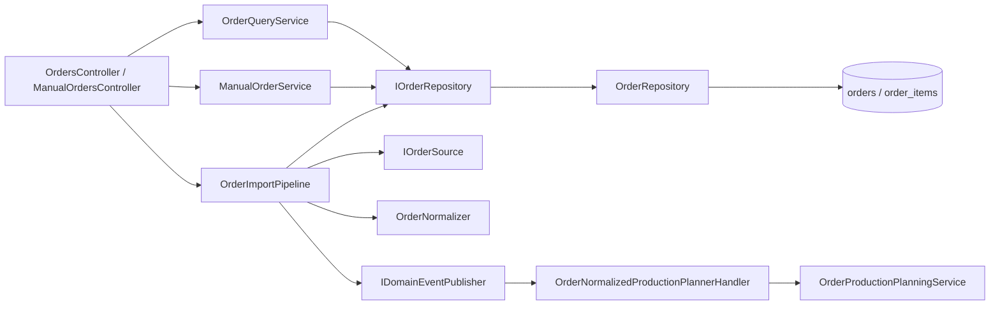
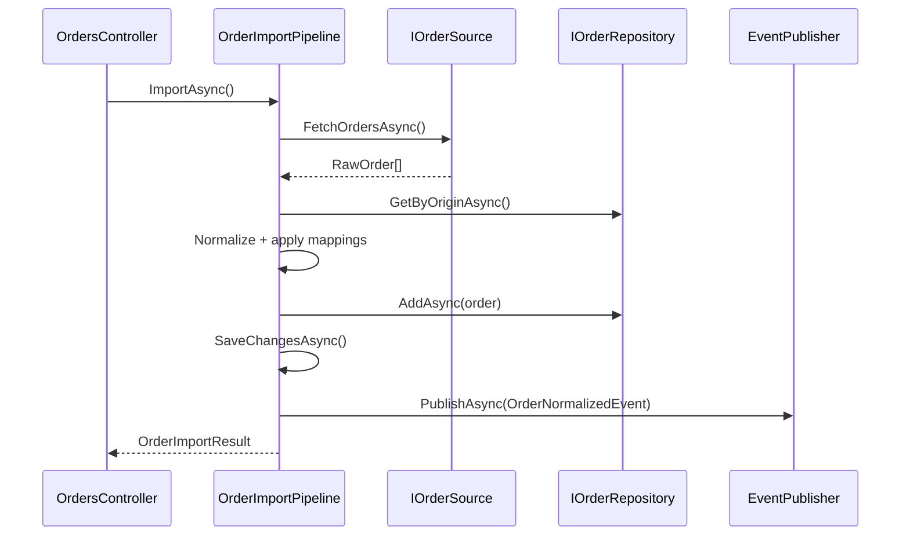

# Componente Orders (`Pedido`) — análise arquitetural

> Status: documentação baseada em evidências.  
> Commit analisado: `4d6c8f8`.  
> Data: 21/11/2026.  
> Nenhum arquivo do repositório foi alterado durante a análise.

## 1. Escopo

**IN**

- Agregado `Craftsman.Domain.Sales.Entities.Order`.
- `OrderItem`, `OrderStatus`, `OrderOrigin` e `OrderDiscount`.
- Repositório e persistência de pedidos.
- Fluxos de importação, criação/edição manual, consulta, exclusão e planejamento de produção diretamente relacionados a pedidos.
- Controllers, serviços e testes necessários para validar esses fluxos.

**CONTEXT**

- Produção, estoque, expedição, clientes, financeiro, eventos de domínio e integrações de marketplace.

**OUT**

- Arquitetura interna completa dos módulos de Finance, Inventory, Production, Shipping e ProductCatalog.

## 2. Propósito e responsabilidades

O pedido representa uma ordem comercial com origem e identificador externo, itens, status operacional, data de criação e envio, cliente opcional, desconto opcional e eventos de domínio pendentes. Isso é confirmado em `src/Domains/Sales/Entities/Order.cs:L6-L29`.

O agregado protege invariantes básicas:

- `Id` não pode ser vazio;
- todo pedido deve conter ao menos um item;
- data de envio informada deve ser futura;
- transições de status seguem uma sequência explícita;
- itens expõem coleção somente leitura.

Evidência: `src/Domains/Sales/Entities/Order.cs:L31-L73` e `L75-L176`.

O item valida identificador, descrição, quantidade positiva e permite associação posterior a um produto: `src/Domains/Sales/Entities/OrderItem.cs`, construtor e `AssignProduct`.

## 3. Arquitetura e contexto



O código evidencia uma separação entre domínio de vendas, serviços de aplicação, contratos de repositório, implementação EF Core, integração de fontes externas e planejamento de produção. Essa separação é observada no registro de dependências em `src/Infra/Services/ServiceCollectionExtensions.cs:L40-L89`.

## 4. Contratos públicos e dependências

| Contrato | Direção | Comportamento observado | Evidência | Certeza |
|---|---|---|---|---|
| `IOrderRepository` | Aplicação → domínio/infraestrutura | Busca por ID, origem, listagem, inclusão, atualização e exclusão | `src/Domains/Sales/Repositories/IOrderRepository.cs` | CONFIRMED |
| `OrderRepository` | Infraestrutura → EF Core | Converte entre `Order` e entidades de persistência | `src/Infra/Repositories/OrderRepository.cs:L22-L202` | CONFIRMED |
| `OrderImportPipeline` | Integração → pedido | Busca pedidos externos, ignora duplicados, normaliza e persiste | `src/Domains/Integration/Services/OrderImportPipeline.cs:L34-L87` | CONFIRMED |
| `ManualOrderService` | Aplicação → pedido | Cria, edita, exclui e associa produtos | `src/App/Services/ManualOrderService.cs:L102-L214`, `L285-L397` | CONFIRMED |
| `OrderQueryService` | Aplicação → leitura | Projeta pedidos para modelos de tela | `src/App/Services/OrderQueryService.cs:L29-L127` | CONFIRMED |
| `IDomainEventPublisher` | Pedido → produção | Publica `OrderNormalizedEvent` | `src/Domains/Integration/Services/OrderImportPipeline.cs:L72-L77` | CONFIRMED |
| `IUnitOfWork` | Serviços → persistência | Confirma alterações via `SaveChangesAsync` | `src/App/Services/ManualOrderService.cs:L153-L163` | CONFIRMED |

## 5. Design interno

### Estado do pedido

Os estados definidos são:

```text
Normalized
  -> ReadyForProduction
  -> InProduction
  -> Shipped
  -> Delivered
```

O cancelamento é permitido antes de `Delivered` e não pode ser repetido. As transições são implementadas em `src/Domains/Sales/Entities/Order.cs:L75-L107`.

A reversão de planejamento permite `ReadyForProduction` ou `InProduction` retornarem para `Normalized`: `src/Domains/Sales/Entities/Order.cs:L155-L163`.

### Eventos de domínio

O construtor cria `OrderNormalizedEvent` por padrão: `src/Domains/Sales/Entities/Order.cs:L69-L72`.

A reconstrução a partir do banco desativa esse evento usando `raiseNormalizedEvent: false`: `src/Infra/Repositories/OrderRepository.cs:L164-L175`.

O evento é persistido e seus handlers são executados pelo `PersistentDomainEventPublisher`: `src/Infra/Services/PersistentDomainEventPublisher.cs:L23-L61`.

O handler de pedidos normalizados tenta planejar a produção: `src/Domains/Production/Services/OrderNormalizedProductionPlannerHandler.cs`.

**CONFIRMED:** existe um agregado de domínio com invariantes e métodos de transição de estado.

**INFERRED:** o objeto `Order` funciona como agregado principal de Sales, pois encapsula itens, status, dados comerciais e eventos, enquanto o repositório opera sobre ele como unidade.

**UNVERIFIED:** não há evidência suficiente para afirmar que toda alteração de pedido ocorra sempre dentro de uma única fronteira transacional.

## 6. Fluxos principais

### Importação externa

1. `OrdersController.Import` exige política de escrita e antiforgery.
2. `OrderImportPipeline` percorre as fontes registradas.
3. Cada fonte fornece `RawOrder`.
4. O pipeline verifica duplicidade por `(Source, ExternalOrderId)`.
5. `OrderNormalizer` cria um `Order`.
6. Mapeamentos externos associam produtos aos itens.
7. O pedido é persistido.
8. Eventos de domínio são publicados.
9. Falhas individuais são acumuladas no resultado, sem interromper toda a importação.

Evidências: `src/App/Controllers/OrdersController.cs:L52-L69`, `src/Domains/Integration/Services/OrderImportPipeline.cs:L34-L87`, `src/Domains/Integration/Services/OrderNormalizer.cs` e o índice composto em `src/Infra/Persistence/Configurations/OrderConfiguration.cs`.



### Criação manual

`ManualOrderService.CreateAsync` exige pelo menos um item preenchido, gera referência `MAN-...` quando necessário, exige data de envio futura, resolve a origem, rejeita referência duplicada, valida produtos associados, resolve ou cria cliente, calcula desconto, persiste o pedido, publica eventos e tenta planejar a produção.

Evidência: `src/App/Services/ManualOrderService.cs:L102-L165` e `L427-L535`.

A entrada HTTP é protegida por validação de modelo, autorização de escrita e antiforgery: `src/App/Controllers/ManualOrdersController.cs:L37-L71`.

### Edição manual

A edição carrega o pedido, resolve origem e referência, verifica duplicidade, reconstrói itens, valida data/cliente/desconto, impede alteração após início efetivo da produção, impede alterações operacionais quando há expedição vinculada, desfaz planejamento prévio, substitui dados, recalcula liquidação financeira quando necessário e tenta planejar novamente se houve alteração operacional.

Evidência: `src/App/Services/ManualOrderService.cs:L168-L214` e `L466-L479`.

### Consulta

`OrderQueryService` oferece listagem resumida, seleção de pedidos para expedição e detalhe com itens, tarefas de produção e remessas: `src/App/Services/OrderQueryService.cs:L29-L127`.

Pedidos cancelados ou entregues não são considerados disponíveis para expedição: `src/App/Services/OrderQueryService.cs:L113-L116`.

### Exclusão

A exclusão cria ou retoma um processo de exclusão, registra dados históricos, compensa saídas de estoque, remove liquidação financeira, remessas e tarefas de produção, remove o pedido e marca o processo como concluído.

Evidência: `src/App/Services/ManualOrderService.cs:L285-L333`.

Há proteção contra duplicação da compensação de estoque usando referência de negócio: `src/App/Services/ManualOrderService.cs:L524-L548`.

## 7. Dados e persistência

O pedido é armazenado em `orders` e seus itens em `order_items`.

### `orders`

- chave primária `id`;
- `source`;
- `external_order_id`;
- `status`;
- `created_at`;
- `shipping_date`;
- `customer_id`;
- descrição e valor do desconto;
- índice único `(source, external_order_id)`.

### `order_items`

- chave primária `id`;
- `order_id`;
- identificador externo;
- descrição;
- quantidade;
- valor e moeda unitários;
- produto opcional.

Evidências: `src/Infra/Persistence/Configurations/OrderConfiguration.cs`, `src/Infra/Persistence/Configurations/OrderItemConfiguration.cs`, `src/Infra/Persistence/Entities/OrderEntity.cs` e `src/Infra/Persistence/Entities/OrderItemEntity.cs`.

A relação pedido-itens usa exclusão em cascata; a relação com cliente usa `Restrict`: `src/Infra/Persistence/Configurations/OrderConfiguration.cs`.

O repositório usa `AsNoTracking` nas leituras e inclui cliente e itens: `src/Infra/Repositories/OrderRepository.cs:L22-L48` e `L130-L145`.

A listagem pode usar cache com a chave `sales:orders:list`, invalidado por prefixo após inclusão, atualização ou exclusão: `src/Infra/Repositories/OrderRepository.cs:L41-L55`, `L115-L128`.

## 8. Resiliência, segurança e observabilidade

### Verificado

- Autorização de leitura no controller de pedidos.
- Política de escrita para operações mutáveis.
- `[ValidateAntiForgeryToken]` nas operações POST.
- Cancelamento propagado por `CancellationToken`.
- Logs estruturados na importação manual e edição.
- Auditoria explícita para importação, envio e reversão de produção.
- Tratamento específico de conflitos de concorrência no envio para produção.
- Timeouts configurados nos `HttpClient` de integrações.

Evidências: `src/App/Controllers/OrdersController.cs:L14-L15`, `L52-L55`, `L79-L82`, `L151-L154`, `L186-L189`; `src/App/Controllers/ManualOrdersController.cs:L13-L14`, `L37-L40`, `L98-L101`; `src/App/Controllers/OrdersController.cs:L98-L148`; `src/Infra/Services/ServiceCollectionExtensions.cs:L91-L142`.

### Não verificado

- Autorização por recurso ou tenant para um `orderId` específico.
- Rate limiting específico para importações.
- Limites explícitos de quantidade de itens ou tamanho de descrições além dos limites do banco.
- Política de retry para fontes externas.
- Scanner de segredos/dependências executado durante esta análise.
- Token explícito de concorrência em `OrderEntity`/`OrderConfiguration`.

A aplicação captura `DbUpdateConcurrencyException`, mas a origem concreta desse conflito não está demonstrada nos arquivos do pedido: `src/App/Controllers/ManualOrdersController.cs:L127-L133` e `src/App/Controllers/OrdersController.cs:L132-L148`.

## 9. Runtime wiring e configuração

O componente é composto via DI:

- `IOrderRepository → OrderRepository`;
- `IOrderImportPipeline → OrderImportPipeline`;
- `IOrderNormalizer → OrderNormalizer`;
- `IOrderSource → InMemoryOrderSource`, possivelmente substituído por `ShopeeOrderSource`;
- `IDomainEventPublisher → PersistentDomainEventPublisher`;
- `OrderQueryService` e `ManualOrderService` registrados como scoped.

Evidência: `src/Infra/Services/ServiceCollectionExtensions.cs:L40-L89` e `src/App/Services/ApplicationServiceCollectionExtensions.cs`.

A conexão do banco é obtida pela configuração `ConnectionStrings:CraftsmanDb`: `src/Infra/Services/ServiceCollectionExtensions.cs:L31-L38`.

A integração Shopee é habilitada por configuração e usa `HttpClient` com timeout: `src/Infra/Services/ServiceCollectionExtensions.cs:L91-L119`.

## 10. Testes relevantes

| Teste | Cobertura | Limitação |
|---|---|---|
| `OrderTests` | Criação, origem, evento, transições inválidas, data futura, cliente e desconto | Não cobre todas as transições possíveis |
| `OrderItemAndSourceTests` | Validação e normalização de itens e origem | Não cobre persistência |
| `OrderNormalizerTests` | Conversão de pedido externo e rejeição sem itens | Não cobre falhas de integrações reais |
| `OrderImportPipelineTests` | Importação válida, falha parcial e duplicidade | Usa repositórios e publisher falsos |
| `OrdersControllerRevertProductionTests` | Reversão e tratamento de concorrência no controller | Escopo limitado ao fluxo testado |
| `ManualOrdersControllerCoverageTests` | Caminhos de controller de pedidos manuais | Não substitui testes de domínio/integrados |

Arquivos:

- `tests/Craftsman.Tests/Sales/OrderTests.cs`
- `tests/Craftsman.Tests/Sales/OrderItemAndSourceTests.cs`
- `tests/Craftsman.Tests/Integration/OrderNormalizerTests.cs`
- `tests/Craftsman.Tests/Integration/OrderImportPipelineTests.cs`
- `tests/Craftsman.Tests/Application/OrdersControllerRevertProductionTests.cs`
- `tests/Craftsman.Tests/Application/ManualOrdersControllerCoverageTests.cs`

Os testes não foram executados nesta análise; foram apenas inspecionados.

## 11. Evidência e incertezas

| ID | Afirmação | Fonte | Certeza |
|---|---|---|---|
| C-01 | `Order` encapsula itens, status e eventos | `Order.cs:L6-L29` | CONFIRMED |
| C-02 | O pedido exige ao menos um item | `Order.cs:L48-L53` | CONFIRMED |
| C-03 | Existem transições explícitas de status | `Order.cs:L75-L163` | CONFIRMED |
| C-04 | A origem externa é única por fonte e referência | `OrderConfiguration.cs` | CONFIRMED |
| C-05 | O repositório converte domínio ↔ EF Core | `OrderRepository.cs:L147-L201` | CONFIRMED |
| C-06 | A importação ignora duplicados | `OrderImportPipeline.cs:L58-L65` | CONFIRMED |
| C-07 | A importação publica evento após persistir | `OrderImportPipeline.cs:L67-L78` | CONFIRMED |
| C-08 | Evento de pedido normalizado aciona planejamento | `OrderNormalizedProductionPlannerHandler.cs` | CONFIRMED |
| C-09 | Edição impede mudanças após produção iniciada | `ManualOrderService.cs:L466-L479` | CONFIRMED |
| C-10 | Exclusão compensa estoque e remove dependências | `ManualOrderService.cs:L306-L332` | CONFIRMED |
| C-11 | Endpoints mutáveis exigem política de escrita e antiforgery | Controllers citados | CONFIRMED |
| I-01 | `Order` atua como agregado de Sales | `Order.cs` + `IOrderRepository` | INFERRED |
| I-02 | O fluxo de eventos pretende fornecer rastreabilidade persistente | `PersistentDomainEventPublisher.cs` | INFERRED |
| U-01 | Autorização por recurso não foi demonstrada | Controllers/repositórios inspecionados | UNVERIFIED |
| U-02 | Token de concorrência específico do pedido não foi demonstrado | `OrderEntity`/`OrderConfiguration` | UNVERIFIED |
| U-03 | Retry de importação externa não foi demonstrado | `OrderImportPipeline.cs` | UNVERIFIED |
| U-04 | Testes de persistência real do pedido não foram localizados no escopo | testes inspecionados | UNVERIFIED |

**Discrepâncias:** o controller trata conflitos de concorrência, mas não foi identificada uma propriedade de concorrência explícita na entidade ou configuração do pedido.

## 12. Verification status

Confirmed: 11 · Inferred: 2 · Unverified: 4 · Contradicted: 0

**Limitações principais:** análise estática; testes não executados; não foi realizada verificação dinâmica de autorização por recurso, concorrência real, banco de dados ou integrações externas.

**Revisão de segurança:** parcial  
**Escopo revisado:** endpoints de Orders, criação/edição/exclusão manual, importação, repositório, persistência e configurações de integração.  
**Verificações executadas:** inspeção manual de código, contratos, testes e configuração; nenhum scanner executado.  
**Achados:** nenhum achado crítico/alto confirmado; autorização por recurso, limites de abuso e concorrência real permanecem não verificados.  
**Riscos residuais:** dependência de validações de modelo e regras de serviço; ausência de evidência de autorização específica por pedido e de token explícito de concorrência.
