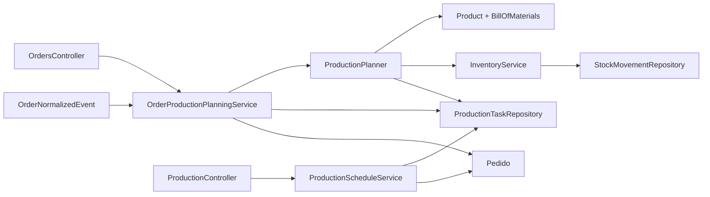
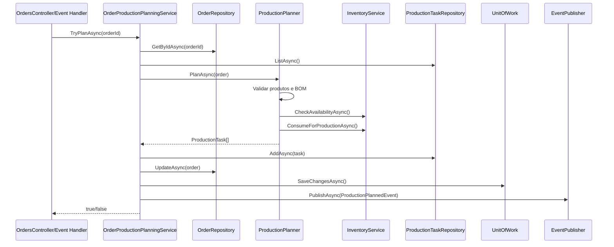

# Fluxo de produção — análise arquitetural

> Status: documentação baseada em evidências.  
> Escopo: planejamento, tarefas de produção, consumo/reversão de estoque, avanço operacional e integração com pedidos.  
> Commit analisado: `4d6c8f8`.

## 1. Escopo

**IN**

- `OrderProductionPlanningService`
- `ProductionPlanner`
- `ProductionTask`
- `ProductionScheduleService`
- `ProductionController`
- `InventoryService`, apenas no contexto do consumo para produção
- Repositórios de tarefas e movimentos de estoque
- Eventos e testes diretamente relacionados ao fluxo

**CONTEXT**

- Pedido, produto, lista de materiais, estoque, remessa e auditoria.

**OUT**

- Arquitetura completa dos módulos de Sales, Inventory, Shipping e ProductCatalog.

## 2. Propósito

O fluxo transforma um pedido com produtos mapeados em tarefas de produção planejadas, verificando:

- existência do pedido;
- associação de cada item a um produto interno;
- produto ativo;
- lista de materiais válida;
- disponibilidade agregada de matérias-primas;
- conflito com tarefas já planejadas;
- janela de produção até a data de envio;
- consumo de estoque;
- transição do pedido para `ReadyForProduction`.

A entrada principal é `OrderProductionPlanningService.TryPlanAsync(orderId)`: `src/Domains/Production/Services/OrderProductionPlanningService.cs:L46-L101`.

## 3. Arquitetura e contexto



O fluxo possui duas entradas verificadas:

1. planejamento automático após `OrderNormalizedEvent`;
2. planejamento explícito pelo controller de pedidos.

O evento é tratado por `OrderNormalizedProductionPlannerHandler`, que delega para `OrderProductionPlanningService.TryPlanAsync`: `src/Domains/Production/Services/OrderNormalizedProductionPlannerHandler.cs`.

O envio manual para produção ocorre em `src/App/Controllers/OrdersController.cs:L79-L129`.

## 4. Contratos e dependências

| Dependência | Responsabilidade observada | Evidência | Certeza |
|---|---|---|---|
| `IOrderRepository` | Carregar e atualizar o pedido | `OrderProductionPlanningService.cs:L17-L18`, `L49-L85` | CONFIRMED |
| `IProductionPlanner` | Criar tarefas e consumir materiais | `OrderProductionPlanningService.cs:L18-L19`, `ProductionPlanner.cs:L29-L91` | CONFIRMED |
| `IProductionTaskRepository` | Persistir, consultar e remover tarefas | `ProductionTaskRepository.cs` | CONFIRMED |
| `IStockMovementRepository` | Consultar saldo, custo e movimentos | `InventoryService.cs:L8-L14`, `StockMovementRepository.cs` | CONFIRMED |
| `IUnitOfWork` | Persistir alterações do planejamento | `OrderProductionPlanningService.cs:L22`, `L89` | CONFIRMED |
| `IDomainEventPublisher` | Publicar eventos de tarefas planejadas | `OrderProductionPlanningService.cs:L15`, `L91-L99` | CONFIRMED |
| `IShipmentRepository` | Impedir reversão após remessa | `OrderProductionPlanningService.cs:L21`, `L110-L117` | CONFIRMED |
| `ProductionScheduleOptions` | Definir jornada de trabalho | `ProductionPlanner.cs:L15-L26`, `ProductionScheduleOptions.cs` | CONFIRMED |

O wiring ocorre em `src/Infra/Services/ServiceCollectionExtensions.cs`, incluindo `OrderProductionPlanningService`, `ProductionPlanner`, `InventoryService`, repositórios e o publisher persistente.

## 5. Modelo de estado

### Tarefa de produção

A tarefa possui os estados:

```text
Planned
  -> InProduction
  -> Completed

Planned/InProduction
  -> Cancelled
```

As transições são encapsuladas em `src/Domains/Production/Entities/ProductionTask.cs`.

- `Start()` só aceita `Planned`;
- `Complete()` só aceita `InProduction`;
- `Cancel()` rejeita tarefas concluídas ou já canceladas.

A tarefa mantém referência para pedido, item do pedido, produto, quantidade, duração, janela planejada e timestamps de início e conclusão.

### Pedido

Ao criar tarefas, o pedido em `Normalized` passa para `ReadyForProduction`: `src/Domains/Production/Services/OrderProductionPlanningService.cs:L81-L87`.

Quando a primeira tarefa é iniciada, o pedido passa para `InProduction`: `src/App/Services/ProductionScheduleService.cs:L64-L106`.

Não foi encontrado neste fluxo código que altere automaticamente o pedido para `Shipped` ou `Delivered` ao concluir tarefas.

**CONFIRMED:** concluir uma tarefa altera apenas o status da tarefa.

## 6. Fluxo de planejamento



Etapas verificadas:

1. O pedido é carregado.
2. O fluxo retorna `false` quando o pedido não existe ou há item sem produto.
3. O fluxo retorna `false` quando já existem tarefas para o pedido.
4. O planner valida cada produto e sua BOM.
5. Os requisitos de materiais são agregados por matéria-prima.
6. A disponibilidade é verificada antes do consumo.
7. Uma tarefa é criada para cada item do pedido.
8. O estoque é consumido por tarefa.
9. As tarefas são adicionadas ao repositório.
10. O pedido é marcado como pronto para produção.
11. As mudanças são persistidas.
12. Eventos `ProductionPlannedEvent` são publicados.

Evidências: `src/Domains/Production/Services/OrderProductionPlanningService.cs:L46-L101` e `src/Domains/Production/Services/ProductionPlanner.cs:L29-L91`.

## 7. Validação de produto e materiais

Cada item do pedido precisa ter `ProductId`: `src/Domains/Production/Services/ProductionPlanner.cs:L41-L46`.

O produto precisa existir e atender `CanBePlannedForProduction`, que exige status ativo e BOM não vazia: `src/Domains/Production/Services/ProductionPlanner.cs:L48-L53`.

A quantidade necessária é calculada como:

```text
Quantidade necessária =
    quantidade do item do pedido
    × quantidade da matéria-prima por unidade
```

Evidência: `src/Domains/Production/Services/ProductionPlanner.cs:L99-L104`.

Requisitos iguais de matérias-primas são agrupados antes da validação: `src/Domains/Production/Services/ProductionPlanner.cs:L60-L67`.

Se houver material insuficiente, nenhuma tarefa é retornada: `src/Domains/Production/Services/ProductionPlanner.cs:L69-L72`.

O `InventoryService` verifica se a matéria-prima existe, pode ser consumida e possui saldo suficiente: `src/Domains/Inventory/Services/InventoryService.cs:L17-L39`.

## 8. Consumo de estoque

Após a validação agregada, o planner chama `InventoryService.ConsumeForProductionAsync(requirements, productionTask.Id)`.

O serviço reconfirma a disponibilidade, calcula custo médio unitário, cria movimento `Outbound` e usa o ID da tarefa como `BusinessReference`.

Evidência: `src/Domains/Inventory/Services/InventoryService.cs:L41-L69`.

O movimento tem razão `"Production consumption"` e referência igual ao ID da tarefa.

Os movimentos são persistidos na tabela `stock_movements`: `src/Infra/Persistence/Configurations/StockMovementConfiguration.cs`.

### Observação importante

O movimento de consumo criado pelo planner não preenche `OrderId`; ele relaciona o consumo à tarefa somente via `BusinessReference`.

Isso é observado em `src/Domains/Production/Services/ProductionPlanner.cs:L87` e `src/Domains/Inventory/Services/InventoryService.cs:L58-L67`.

**INFERRED:** o vínculo operacional do consumo com o pedido é indireto: pedido → tarefa → `BusinessReference` do movimento.

## 9. Agendamento

A janela planejada é calculada retroativamente a partir da data de envio: `src/Domains/Production/Services/ProductionPlanner.cs:L107-L130`.

A duração é:

```text
Duração do produto × quantidade do item
```

Evidência: `src/Domains/Production/Services/ProductionPlanner.cs:L74-L86`.

A configuração padrão é início da jornada às 08:00 UTC e duração de 6 horas por dia: `src/Domains/Production/Services/ProductionScheduleOptions.cs`.

O planner ignora tarefas canceladas, procura conflitos de intervalo, move a janela para antes da tarefa conflitante e atravessa dias anteriores quando necessário.

Evidências: `src/Domains/Production/Services/ProductionPlanner.cs:L107-L129` e `L132-L199`.

### Possível diferença de referência temporal

O planner calcula horários em UTC, enquanto `ProductionController` e `ProductionScheduleService` usam `TimeProvider.GetLocalNow()` para selecionar a data exibida:

- `src/Domains/Production/Services/ProductionPlanner.cs:L186-L194`
- `src/App/Services/ProductionScheduleService.cs:L33-L45`
- `src/App/Controllers/ProductionController.cs:L26-L35`

**UNVERIFIED:** não foi confirmado se essa diferença é intencional ou se pode causar divergência entre o calendário exibido e as janelas planejadas.

## 10. Avanço operacional

`ProductionController.Advance` exige usuário autenticado com política de escrita, antiforgery e ação textual `start`, `complete` ou `cancel`.

Evidência: `src/App/Controllers/ProductionController.cs:L61-L81`.

`ProductionScheduleService.AdvanceAsync` carrega a tarefa, aplica a transição, ao iniciar também atualiza o pedido e persiste tarefa e pedido no mesmo `UnitOfWork`: `src/App/Services/ProductionScheduleService.cs:L64-L106`.

A operação é auditada como `ProductionAdvanced`: `src/App/Controllers/ProductionController.cs:L68-L74`.

## 11. Reversão do planejamento

`OrderProductionPlanningService.RevertAsync`:

1. carrega o pedido;
2. busca tarefas do pedido;
3. rejeita reversão se houver remessa;
4. rejeita reversão se alguma tarefa estiver concluída;
5. retorna `false` se não houver tarefas e o pedido já estiver normalizado;
6. localiza movimentos `Outbound` por ID da tarefa;
7. cria movimentos `Inbound` compensatórios;
8. evita duplicação usando `production-reversal:{movement.Id}`;
9. remove as tarefas;
10. retorna o pedido para `Normalized`;
11. persiste tudo.

Evidência: `src/Domains/Production/Services/OrderProductionPlanningService.cs:L104-L166`.

```mermaid
flowchart TD
    Start[RevertAsync(orderId)] --> Load[Carregar pedido e tarefas]
    Load --> Shipment{Existe remessa?}
    Shipment -->|Sim| Fail1[Rejeitar]
    Shipment -->|Não| Completed{Existe tarefa concluída?}
    Completed -->|Sim| Fail2[Rejeitar]
    Completed -->|Não| Empty{Não há tarefas?}
    Empty -->|Sim + Normalized| False[Retornar false]
    Empty -->|Não| Compensate[Adicionar entradas compensatórias]
    Compensate --> Delete[Excluir tarefas]
    Delete --> Normalize[Pedido -> Normalized]
    Normalize --> Save[Persistir]
    Save --> True[Retornar true]
```

A reversão é idempotente quanto à compensação de estoque, pois verifica a referência antes de inserir: `src/Domains/Production/Services/OrderProductionPlanningService.cs:L140-L157`.

## 12. Persistência

Tarefas são armazenadas em `production_tasks` com `OrderId`, `OrderItemId`, `ProductId`, quantidade, duração, status, janela planejada e timestamps de início e conclusão.

Evidências: `src/Infra/Persistence/Entities/ProductionTaskEntity.cs` e `src/Infra/Persistence/Configurations/ProductionTaskConfiguration.cs`.

Há índices para pedido, status e início planejado.

O repositório invalida cache com prefixo `production:` após inclusão, atualização ou exclusão: `src/Infra/Repositories/ProductionTaskRepository.cs`.

Movimentos de estoque usam cache de saldo, movimentos e alertas, invalidado quando um movimento é incluído ou removido: `src/Infra/Repositories/StockMovementRepository.cs`.

## 13. Falhas, segurança e observabilidade

### Confirmado

- Falhas de produto ausente, produto inativo, BOM inválida e estoque insuficiente retornam como falha de planejamento.
- `TryPlanAsync` converte `InvalidOperationException` do planner em `false` e registra warning.
- Controllers exigem autenticação de leitura.
- Operações mutáveis exigem política de escrita.
- Operações POST usam antiforgery.
- Cancelamento é propagado via `CancellationToken`.
- Logs são emitidos no planejamento.
- Avanços operacionais são auditados.
- Reversão impede operação após remessa ou tarefa concluída.

Evidências: `OrderProductionPlanningService.cs:L48-L72`, `ProductionController.cs:L9-L10`, `L61-L79` e `OrderProductionPlanningService.cs:L110-L122`.

### Não verificado

- Lock ou controle de concorrência durante duas chamadas simultâneas de planejamento.
- Garantia de que duas requisições não consumam o mesmo saldo antes de persistir.
- Retry de falhas transitórias de banco ou estoque.
- Rollback explícito envolvendo tarefas, pedido e movimentos.
- Autorização específica por pedido ou tarefa.
- Tratamento de cancelamento parcial após alguns movimentos já terem sido adicionados ao contexto.

**Risco residual:** a verificação de saldo e a criação dos movimentos são operações separadas; não foi localizada uma trava explícita ou transação serializável dentro de `OrderProductionPlanningService`.

## 14. Runtime wiring e configuração

O fluxo é registrado em `src/Infra/Services/ServiceCollectionExtensions.cs`:

- `OrderProductionPlanningService`;
- `IProductionPlanner → ProductionPlanner`;
- `InventoryService`;
- `IProductionTaskRepository → ProductionTaskRepository`;
- `IStockMovementRepository → StockMovementRepository`;
- `IDomainEventPublisher → PersistentDomainEventPublisher`;
- handler de `OrderNormalizedEvent`.

A configuração `Production` em `appsettings.json` alimenta `ProductionScheduleOptions`, com `WorkingHoursPerDay` e `WorkdayStartHour`.

## 15. Testes relevantes

| Teste | Comportamento verificado | Limitação |
|---|---|---|
| `ProductionPlannerTests` | Consumo de estoque, cálculo de duração, BOM, disponibilidade agregada e janelas | Usa banco InMemory |
| `OrderProductionPlanningConsistencyTests` | Eventos só são publicados após persistência do planejamento | Não testa falha do publisher |
| `OrderProductionPlanningReversalTests` | Compensação, exclusão de tarefas, idempotência e bloqueio de tarefa concluída | Não cobre concorrência |
| `ProductionTaskTests` | Invariantes e transições da tarefa | Não cobre persistência |
| `ProductionControllerTests` | Fluxo HTTP de avanço | Não valida banco real |
| `ProductionScheduleServiceTests` | Listagem e avanço operacional | Cobertura limitada a cenários testados |

Arquivos:

- `tests/Craftsman.Tests/Production/ProductionPlannerTests.cs`
- `tests/Craftsman.Tests/Production/OrderProductionPlanningConsistencyTests.cs`
- `tests/Craftsman.Tests/Production/OrderProductionPlanningReversalTests.cs`
- `tests/Craftsman.Tests/Production/ProductionTaskTests.cs`
- `tests/Craftsman.Tests/Production/ProductionControllerTests.cs`
- `tests/Craftsman.Tests/Production/ProductionScheduleServiceTests.cs`

Os testes não foram executados nesta análise.

## 16. Evidência e incertezas

| ID | Afirmação | Fonte | Certeza |
|---|---|---|---|
| C-01 | O planejamento começa por `TryPlanAsync(orderId)` | `OrderProductionPlanningService.cs:L46-L101` | CONFIRMED |
| C-02 | Pedido sem produto mapeado não é planejado | `OrderProductionPlanningService.cs:L51-L55` | CONFIRMED |
| C-03 | Pedidos com tarefas existentes são ignorados | `OrderProductionPlanningService.cs:L57-L62` | CONFIRMED |
| C-04 | Produtos precisam estar ativos e possuir BOM | `ProductionPlanner.cs:L48-L53` | CONFIRMED |
| C-05 | Requisitos são agregados por matéria-prima | `ProductionPlanner.cs:L60-L67` | CONFIRMED |
| C-06 | O estoque é consumido por tarefa | `ProductionPlanner.cs:L74-L89` | CONFIRMED |
| C-07 | O pedido passa para `ReadyForProduction` após planejamento | `OrderProductionPlanningService.cs:L81-L87` | CONFIRMED |
| C-08 | Iniciar uma tarefa coloca o pedido em `InProduction` | `ProductionScheduleService.cs:L64-L106` | CONFIRMED |
| C-09 | Concluir tarefa não altera automaticamente o pedido | `ProductionScheduleService.cs:L69-L86` | CONFIRMED |
| C-10 | Reversão compensa estoque e remove tarefas | `OrderProductionPlanningService.cs:L134-L166` | CONFIRMED |
| C-11 | Compensação é protegida por referência idempotente | `OrderProductionPlanningService.cs:L142-L157` | CONFIRMED |
| C-12 | Eventos de planejamento são publicados após o save | `OrderProductionPlanningService.cs:L89-L99` | CONFIRMED |
| I-01 | O vínculo de consumo com pedido é indireto via tarefa | `ProductionPlanner.cs:L78-L87` + `StockMovement.cs` | INFERRED |
| I-02 | O fluxo pretende manter consistência entre pedido, tarefas e estoque | serviço + testes de consistência | INFERRED |
| U-01 | Concorrência entre planejamentos simultâneos não foi verificada | `OrderProductionPlanningService.cs` | UNVERIFIED |
| U-02 | Transação serializável no planejamento não foi demonstrada | `OrderProductionPlanningService.cs` | UNVERIFIED |
| U-03 | Diferença UTC/local no calendário não foi esclarecida | `ProductionPlanner.cs` + `ProductionScheduleService.cs` | UNVERIFIED |
| U-04 | Não há evidência de transição automática para `Shipped`/`Delivered` | fluxo inspecionado | UNVERIFIED |

## 17. Verification status

Confirmed: 12 · Inferred: 2 · Unverified: 4 · Contradicted: 0

**Limitações principais:** análise estática; testes não executados; concorrência real, atomicidade entre estoque/tarefas/pedido e alinhamento UTC/local não foram validados dinamicamente.

**Revisão de segurança:** parcial  
**Escopo revisado:** controllers de produção e pedidos, planejamento, tarefas, consumo/reversão de estoque, persistência, eventos e testes.  
**Verificações executadas:** inspeção manual de código, wiring, configuração e testes existentes; nenhum scanner ou teste foi executado.  
**Achados:** nenhum achado crítico/alto confirmado; concorrência e atomicidade do planejamento permanecem não verificadas.  
**Riscos residuais:** possível janela entre verificação e consumo de estoque; ausência de evidência de transação/lock específico no serviço de planejamento; diferença potencial entre horários UTC e datas locais.
